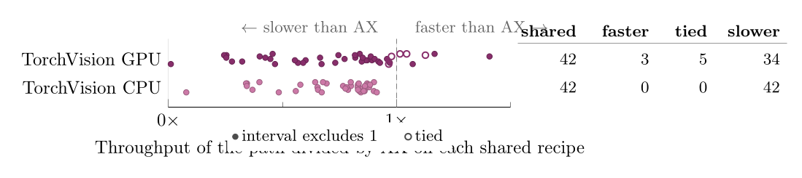
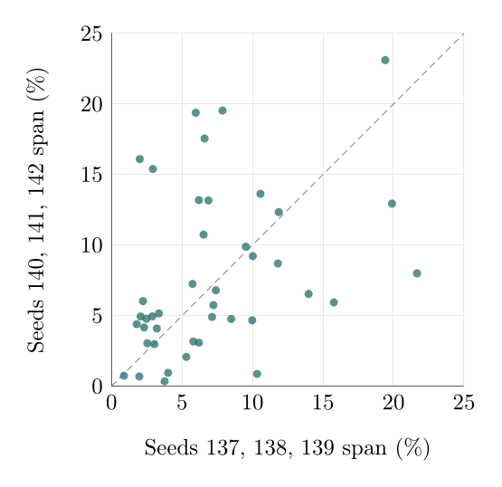

# Augmentation Benchmark

## Citing

If you use this code, benchmark results, or methodology in your research, please cite
[RGB Input Pipelines: Throughput, GPU Memory, and Transformation Coverage](https://arxiv.org/abs/2609.06635).
Your citation makes the project's research impact visible to funders and helps sustain maintenance.

```bibtex
@misc{iglovikov2026rgbinputpipelines,
  title={RGB Input Pipelines: Throughput, GPU Memory, and Transformation Coverage},
  author={Vladimir Iglovikov},
  year={2026},
  eprint={2609.06635},
  archivePrefix={arXiv},
  primaryClass={cs.PF},
  url={https://arxiv.org/abs/2609.06635}
}
```

## About the benchmark

Eight RGB input paths take ImageNet JPEGs from disk to a normalized CUDA batch.
Each measurement records throughput and peak process GPU memory together.
The CPU paths include AlbumentationsX, Pillow, and Pillow-AllSIMD in fast mode.
TorchVision and Kornia each have a CPU and a GPU path. DALI uses its native GPU pipeline.

The workload models image classification on 8-bit RGB inputs. Each sample contains one image with
no bounding boxes, masks, keypoints, or additional targets. The benchmark includes augmentation
libraries (AlbumentationsX, TorchVision, Kornia) and preprocessing libraries (Pillow, Pillow-AllSIMD,
DALI). Native AlbumentationsX transforms define the reference effects. We adapt TorchVision and
Kornia to match them and assemble the preprocessing paths from library primitives.

The separate [grayscale Colorize workload](docs/benchmark_execution_contract.md#grayscale-colorize-workload)
starts with one-channel ImageNet JPEGs prepared offline and returns an RGB batch.

TorchVision GPU uses TorchCodec and the L4's hardware JPEG decoder. Kornia GPU decodes and forms collatable shapes on the CPU, then applies the remaining transforms on the GPU. The methodology FAQ explains the decoder choices and how the adapters match the reference effects. [Methodology FAQ](docs/benchmark_faq.md)

The current manuscript includes per-recipe results, GPU memory, and transformation coverage. The September preprint reports the earlier seven-path experiment. [Manuscript](paper/main.tex) · [Reproduction instructions](paper/README.md) · [September preprint](https://arxiv.org/abs/2609.06635)

<!-- BEGIN GENERATED RESULTS -->

## RGB results

1263 measurements across 421 implementation–recipe pairs, with 3 seeds per pair. See the [per-seed results and manifests](docs/generated/results.json).


### Mean per-recipe throughput ratios

All rows below use the same 31 recipes. Throughput is the arithmetic mean of per-recipe ratios: each path's median over 3 seeds divided by AX's median for that recipe. GPU memory is the median of those recipes' peak-memory medians.

| Measured path | Version | Mean throughput / AX (higher is faster) | Peak process GPU memory (MiB, lower is better) |
| --- | --- | ---: | ---: |
| DALI GPU | 2.4.0 | 1.82× | 784 |
| AlbumentationsX CPU | 2.6.7 | 1.00× | 404 |
| Pillow-AllSIMD CPU (fast) | 13.0.0.post4 | 0.90× | 330 |
| TorchVision GPU | 0.29.2 | 0.81× | 1,250 |
| TorchVision CPU | 0.29.2 | 0.81× | 330 |
| Pillow CPU | 13.0.0 | 0.72× | 330 |
| Kornia GPU | 0.9.2 | 0.49× | 538 |
| Kornia CPU | 0.9.2 | 0.40× | 440 |

Across 46 shared recipes, Pillow-AllSIMD was 1.54× as fast as Pillow on average, with a 1.28× median ratio. Its R27 MedianBlur ratio was 10.41×.

Each implementation and seed ran in a fresh process. NVML sampled its baseline before pipeline setup.

### Throughput ratio on each shared recipe

Each value is the path's median throughput across three seeds divided by AX's median for that recipe. A value above 1.00 means that path delivered batches faster than AX.

| Shared recipe | DALI | Kornia CPU | Kornia GPU | Pillow | Pillow-AllSIMD | TorchVision CPU | TorchVision GPU |
| --- | ---: | ---: | ---: | ---: | ---: | ---: | ---: |
| R01 Resize | 1.47 | 0.47 | 0.48 | 0.57 | 0.83 | 0.82 | 0.92 |
| R02 RandomCrop224 | 1.86 | 0.49 | 0.50 | 0.94 | 0.96 | 0.93 | 1.20 |
| R03 RandomResizedCrop | 1.78 | 0.42 | 0.43 | 0.58 | 0.84 | 0.77 | 0.66 |
| R04 HorizontalFlip | 2.18 | 0.54 | 0.59 | 1.08 | 1.12 | 1.07 | 1.10 |
| R05 VerticalFlip | 1.95 | 0.47 | 0.53 | 0.99 | 1.00 | 0.95 | 1.02 |
| R07 Rotate | 2.02 | 0.35 | 0.55 | 0.66 | 0.94 | 0.57 | 0.39 |
| R08 Affine | 1.89 | 0.33 | 0.54 | 0.66 | 0.93 | 0.66 | 0.45 |
| R09 Perspective | 1.65 | 0.35 | 0.58 | 0.67 | 0.94 | 0.66 | 0.32 |
| R12 ChannelShuffle | 1.79 | 0.45 | 0.48 | 0.90 | 0.91 | 0.86 | 0.82 |
| R13 Grayscale | 1.80 | 0.43 | 0.47 | 0.86 | 0.92 | 0.81 | 0.81 |
| R15 GaussianBlur | 1.93 | 0.28 | 0.51 | 0.45 | 0.85 | 0.54 | 0.57 |
| R17 Invert | 1.75 | 0.42 | 0.46 | 0.83 | 0.87 | 0.85 | 0.86 |
| R18 Posterize | 1.75 | 0.34 | 0.46 | 0.81 | 0.86 | 0.85 | 0.87 |
| R19 Solarize | 1.82 | 0.42 | 0.49 | 0.88 | 0.92 | 0.78 | 0.93 |
| R22 Equalize | 2.15 | 0.40 | 0.57 | 0.95 | 0.98 | 0.77 | 0.42 |
| R24 JpegCompression | 2.07 | 0.16 | 0.55 | 0.87 | 0.87 | 0.83 | 0.76 |
| R25 RandomGamma | 1.84 | 0.38 | 0.48 | 0.87 | 0.90 | 0.68 | 1.07 |
| R30 Brightness | 1.86 | 0.45 | 0.50 | 0.88 | 0.88 | 0.83 | 0.90 |
| R31 Contrast | 1.89 | 0.44 | 0.50 | 0.84 | 0.86 | 0.77 | 0.79 |
| R46 Shear | 1.96 | 0.34 | 0.53 | 0.63 | 0.91 | 0.65 | 0.45 |
| R50 LongestMaxSize | 1.81 | 0.34 | 0.35 | 0.33 | 0.78 | 0.87 | 0.83 |
| R51 SmallestMaxSize | 2.09 | 0.29 | 0.32 | 0.25 | 0.73 | 0.95 | 1.07 |
| R53 RandomRotate90 | 1.81 | 0.31 | 0.48 | 0.91 | 0.93 | 0.88 | 0.99 |
| R58 CenterCrop | 1.91 | 0.56 | 0.58 | 0.95 | 0.96 | 0.95 | 1.54 |
| R59 Crop | 1.54 | 0.44 | 0.47 | 0.54 | 0.84 | 0.83 | 0.89 |
| R62 PadIfNeeded | 1.58 | 0.44 | 0.46 | 0.98 | 1.01 | 0.97 | 1.24 |
| R63 RGB <-> BGR | 1.59 | 0.50 | 0.52 | 0.61 | 0.88 | 0.83 | 0.80 |
| R67 RandomScale | 1.84 | 0.33 | 0.34 | 0.31 | 0.76 | 0.87 | 0.90 |
| R68 RandomSizedCrop | 1.58 | 0.38 | 0.51 | 0.45 | 0.81 | 0.76 | 0.62 |
| R69 CoarseDropout | 1.57 | 0.42 | 0.51 | 0.62 | 0.90 | 0.82 | 0.57 |
| R72 ShiftScaleRotate | 1.67 | 0.35 | 0.56 | 0.48 | 0.88 | 0.64 | 0.44 |

### AlbumentationsX against each library

Each chart uses the recipes shared by every path it shows. Compare rows within each chart.





### TorchVision GPU repeatability

The repeat run adds 126 measurements across 42 recipes with seeds 140, 141, 142. The median throughput span across recipes was 5.8% versus 6.2% in the primary run. The largest span in the repeat was 23.1%. Each seed ran on a different VM, so the span includes variation from the data, transforms, and VM.



The cross-library tables use seeds 137, 138, 139. The values for all six seeds are in the [repeat CSV](paper/generated/torchvision-gpu-repeats.csv).

### Measurement settings

Machine: `g2-standard-16`, `nvidia-l4`. Output: CUDA `float16` BCHW `256x3x224x224`. Dataset: 49,999 non-CMYK ImageNet validation JPEGs with EXIF stripped before timing. Seeds: 137, 138, 139. Workers: 15; prefetch setting: 2; persistent workers: true; dataset prewarm: true.

Warm-up batches: 30. Throughput measures 100 batches (25,600 images), ending after CUDA synchronization. Construction and worker startup are excluded; prefetch effects remain.

GPU memory is sampled by NVML every 50 ms from before pipeline construction through final synchronization and cleanup in the same pass. The peak includes process and library allocations. Shorter peaks may be missed; CPU and model memory are not measured.


<!-- END GENERATED RESULTS -->

## How to read the comparisons

- Resize (R01) and RandomResizedCrop (R03) use bilinear interpolation without
  antialiasing. AX uses OpenCV `INTER_LINEAR`. The two Pillow paths use an
  affine resampling call because Pillow's bilinear resize filters when downsampling.
- Shear (R46) draws an X shear angle from −10° to +10° per image. The paths use bilinear sampling with zero fill.
- Pillow and Pillow-AllSIMD augment on CPU, transfer the pinned `uint8` batch
  to CUDA, then normalize on GPU. The AllSIMD worker recorded AVX2 in fast mode.
- AX uses its batch `InputNormalizer` on GPU. Preflight verified the fused
  Triton path on a full `256×3×224×224` batch. The timed results cover the
  complete input pipeline.
- RandomCrop224 takes a crop at decoded resolution. DALI uses an integer-offset
  slice with centered zero padding where needed.
- R08 applies scale, rotation, X/Y shear, and translation in all eight paths.
  R24 samples JPEG quality per image, although codec paths and artifact
  simulators can produce different pixels at the same nominal quality.

Three seeds provide repeated executions with the same per-seed file order across
paths. The results measure input preparation on one machine type. Performance
during training also depends on the model and its use of the GPU.

## Update the README results

Regenerate the paper and README from the validated primary matrix and the TorchVision GPU repeat. The exports retain every observation's source run and cell IDs. [Regeneration commands](paper/README.md#regenerate-the-results)

The expanded run changed the JPEG selection, timing window, and some recipes and packages. The prior comparison records observed throughput changes under those conditions. [Comparison with the previous run](docs/results/2026-11-20.md)

## Transformation coverage

The census counts counterparts to selected 2D RGB entries in AlbumentationsX, including direct operators and compositions. The manuscript marks approximate matches and gives the releases reviewed for the census. Sampling, border handling, and annotation support can differ. [Coverage catalog](catalog/operations.yaml)

## Run the RGB matrix

Read [the execution contract](docs/benchmark_execution_contract.md) before changing or launching a run. Configure [GCP access](configs/cloud/gcp-l4.yaml) and access to the [dataset archive](configs/families/rgb.yaml), then commit the intended inputs. With `uv` and an authenticated `gcloud` installed, run from the repository root:

```bash
uv run augbench launch-rgb --max-workers 24
```

The launcher requires a clean worktree. It validates existing cells and queues only missing work for the frozen run. Each L4 VM runs one implementation and seed at a time. The pool size is configurable. The paper can be built from the checked-in generated inputs. [Build instructions](paper/README.md#build-the-pdf)

## Repository layout

```text
catalog/       operation census and RGB recipes
configs/       workload and GCP configuration
environments/  locked RGB benchmark environment
infra/gcp/     VM bootstrap
src/augbench/  benchmark implementation
paper/         manuscript, bibliography, generated tables, and per-seed data
```

The runner supports RGB and a separate grayscale Colorize workload. Nine-channel images, video, and volumes each require their own dataset, recipes, implementations, and output contract.
