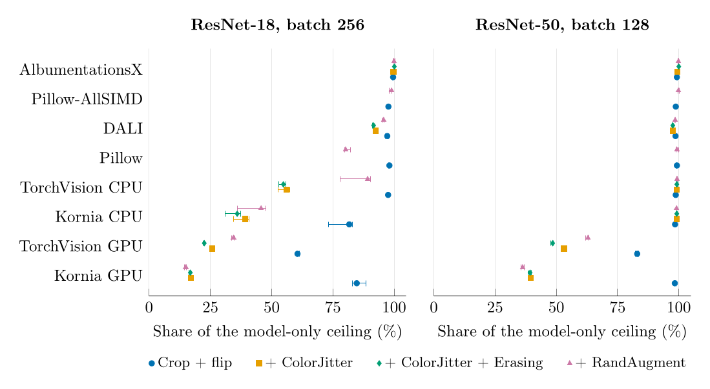

# Augmentation input-pipeline benchmark

This benchmark measures eight ways to turn ImageNet JPEG files into a normalized batch on one NVIDIA L4 GPU. For each path it records how many images per second reach the GPU, how much GPU memory the process holds, and how fast a ResNet trains when that path feeds it. The paths are AlbumentationsX, Pillow, Pillow-AllSIMD, TorchVision and Kornia on the CPU and on the GPU, and NVIDIA DALI.

The author maintains AlbumentationsX. Every setting is fixed in the [execution contract](docs/benchmark_execution_contract.md) before a run, and the code, run manifests, and per-seed results are public. The [preprint](paper/main.tex) describes the method and results in full.


The data loader prepares the next batch while the GPU trains on the current one. If the GPU finishes first, it waits. How long it waits depends on the JPEG decoder, the augmentations, where they run, and how many CPU cores prepare batches. Timing single operators cannot answer that, so this benchmark times the whole path, from files on disk to a batch the model can use.

<!-- BEGIN GENERATED RESULTS -->

## Results

- **Input pipeline alone.** DALI delivers the most images per second: 6,271, the median over the 31 recipes all paths share, while holding 1,744 MiB of GPU memory. The CPU paths deliver 1,867 to 4,348 images/s and hold 300 to 440 MiB.
- **ResNet-18 training step (1,703 images/s without input).** AlbumentationsX and Pillow-AllSIMD keep the step at 95% or more of that rate on every recipe. On their heaviest recipe the others reach 15% (Kornia GPU), 22% (TorchVision GPU), 36% (Kornia CPU), 55% (TorchVision CPU), 79% (Pillow) and 94% (DALI).
- **ResNet-50 training step (529 images/s without input).** AlbumentationsX, Pillow, TorchVision CPU, Kornia CPU, DALI and Pillow-AllSIMD keep the step at 95% or more of that rate on every recipe. On their heaviest recipe the others reach 37% (Kornia GPU) and 48% (TorchVision GPU).

2,105 input-pipeline measurements cover 421 path–recipe pairs with 5 seeds each. Every measurement records throughput and peak process GPU memory in the same pass. [Per-seed results](docs/generated/results.json) · [training-step results](docs/generated/training-summary.md)

### Input pipeline alone

The timer runs from JPEG files on local disk to a normalized CUDA `float16` batch of 256×3×224×224. Each path uses its own decoder and places its work on the CPU or the GPU.


Medians over the 31 recipes that all eight paths support:

| Path | Version | Images/s | Slowest to fastest recipe | Peak GPU memory (MiB) |
| --- | --- | ---: | ---: | ---: |
| DALI | 2.4.0 | 6,271 | 4,659–6,491 | 1,744 |
| AlbumentationsX | 2.6.9 | 4,348 | 3,528–5,072 | 300 |
| Pillow-AllSIMD | 13.0.0.post4 | 3,839 | 2,374–5,226 | 330 |
| TorchVision CPU | 0.29.2 | 3,537 | 2,074–4,662 | 330 |
| Pillow | 13.0.0 | 3,525 | 817–4,381 | 330 |
| TorchVision GPU | 0.29.2 | 2,507 | 918–4,770 | 992 |
| Kornia GPU | 0.9.2 | 2,198 | 972–3,319 | 538 |
| Kornia CPU | 0.9.2 | 1,867 | 658–3,256 | 440 |

### Each path against AlbumentationsX

The author maintains AlbumentationsX (AX), and AX transforms define the reference effect of each recipe. This section therefore compares every path with AX on the recipes both support. A recipe counts as faster or slower only when the exact 95% interval over seeds excludes equal throughput; the rest are tied.


| Path | Shared recipes | Path faster | Tied | AX faster | Median ratio, path / AX |
| --- | ---: | ---: | ---: | ---: | ---: |
| DALI | 51 | 48 | 3 | 0 | 1.38 |
| Pillow-AllSIMD | 46 | 1 | 23 | 22 | 0.92 |
| TorchVision CPU | 42 | 0 | 11 | 31 | 0.83 |
| Pillow | 46 | 1 | 10 | 35 | 0.79 |
| TorchVision GPU | 42 | 0 | 2 | 40 | 0.58 |
| Kornia GPU | 61 | 1 | 0 | 60 | 0.53 |
| Kornia CPU | 61 | 0 | 0 | 61 | 0.39 |

### Feeding a training step

Here every delivered batch feeds one training step of an untrained torchvision ResNet: `torch.compile`, bfloat16 autocast, SGD, on the same L4. The *ceiling* is the same step on a batch already in GPU memory, measured in the same process before the loader starts. A path at 100% keeps the model fully fed; below that, the model waits for input or shares the GPU with the path's own work.



**ResNet-18, batch 256.** Ceiling 1,703 images/s. Each cell is the share of the ceiling, with images/s in parentheses.

| Path | Crop + flip | + ColorJitter | + ColorJitter + Erasing | + RandAugment |
| --- | ---: | ---: | ---: | ---: |
| AlbumentationsX | 99% (1,734) | 100% (1,714) | 100% (1,697) | 100% (1,701) |
| Pillow-AllSIMD | 98% (1,663) | – | – | 99% (1,675) |
| DALI | 96% (1,659) | 95% (1,612) | 94% (1,614) | 96% (1,635) |
| Pillow | 98% (1,716) | – | – | 79% (1,373) |
| TorchVision CPU | 98% (1,715) | 56% (973) | 55% (936) | 89% (1,516) |
| Kornia CPU | 79% (1,349) | 38% (640) | 36% (600) | 46% (770) |
| TorchVision GPU | 61% (1,045) | 26% (441) | 22% (381) | 34% (582) |
| Kornia GPU | 87% (1,490) | 17% (286) | 17% (285) | 15% (254) |

**ResNet-50, batch 128.** Ceiling 529 images/s. Each cell is the share of the ceiling, with images/s in parentheses.

| Path | Crop + flip | + ColorJitter | + ColorJitter + Erasing | + RandAugment |
| --- | ---: | ---: | ---: | ---: |
| AlbumentationsX | 99% (535) | 99% (529) | 100% (529) | 100% (528) |
| Pillow-AllSIMD | 99% (522) | – | – | 100% (526) |
| Kornia CPU | 98% (523) | 99% (524) | 99% (523) | 99% (524) |
| TorchVision CPU | 99% (529) | 99% (523) | 99% (523) | 99% (523) |
| Pillow | 99% (532) | – | – | 99% (525) |
| DALI | 99% (523) | 98% (518) | 98% (516) | 98% (521) |
| TorchVision GPU | 83% (440) | 53% (280) | 48% (255) | 63% (331) |
| Kornia GPU | 98% (520) | 40% (209) | 39% (207) | 37% (193) |

A dash means the path has no implementation of that recipe. Kornia GPU and TorchVision GPU augment on the GPU inside the training loop, so their work takes GPU time from the step.

### Measurement settings

One Standard `g2-standard-16` VM with one `nvidia-l4` per job. Input pipeline: the first 10,000 sorted ImageNet validation JPEGs, 1 warm-up batch and 32 measured batches (8,192 images). Training step: all 50,000 validation JPEGs, 10 warm-up and 150 measured batches. Seeds: 137, 138, 139, 140, 141; every path reads the same file order for a given seed. DataLoader paths use 15 workers with prefetch factor 2; DALI uses the same number of threads.

NVML samples the process's GPU memory every 50 ms from before pipeline construction to the end of the cell. Short peaks between samples can be missed. CPU memory is not measured. Training runs: `6fee5174725e` (ResNet-18), `cb7c84e476ed` (ResNet-50). Input-pipeline run: `d89b7ecffa4c`.

<!-- END GENERATED RESULTS -->

## How to read the results

- **Units.** Throughput is images per second. Each path–recipe pair is the median over five seeds. Each seed ran as a separate job, usually on a different VM, so the spread includes machine-to-machine variation.
- **Ties.** A path counts as faster or slower than another on a recipe only when the exact 95% interval of their throughput ratio over seeds excludes 1. Tied means the seeds cannot separate the two; it does not prove they are equal. The preprint's section *Reading the numbers* explains the interval.
- **Same effect, different pixels.** AlbumentationsX transforms define what each recipe should do. The other paths use their own operators with parameters set toward that effect, so crop rounding, interpolation arithmetic, and samplers still differ. The [contract](docs/benchmark_execution_contract.md#rgb-workload-and-reference-implementations) lists the differences.
- **Training ceiling.** In the training-step results, 100% is the rate of the same compiled step on a batch already in GPU memory, measured in the same process. Below 100%, the model waits for input or shares the GPU with the path's own work.
- **One operating point.** One L4, 16 vCPUs, 15 workers, files in the page cache. Another GPU, more or fewer cores, cold storage, or larger images can change the ranking. The benchmark does not measure image quality or model accuracy.

## What is measured

| Path | JPEG decoder | Before the copy to the GPU | On the GPU |
| --- | --- | --- | --- |
| AlbumentationsX | SimpleJPEG | Augment `uint8`, `ToTensorV2`, copy `uint8` | Normalize |
| Pillow, Pillow-AllSIMD | Pillow (the AllSIMD build for the second) | Augment, copy `uint8` | Normalize |
| TorchVision CPU | TorchVision I/O | Augment `uint8`, copy | Normalize |
| TorchVision GPU | TorchCodec, hardware nvJPEG | Read JPEG bytes | Decode, augment each image, normalize |
| Kornia CPU | Kornia Rust reader | Augment `float32`, copy `float16` | Normalize |
| Kornia GPU | Kornia Rust reader | Decode, crop | Augment, normalize |
| DALI | Mixed CPU/GPU decoder | Read | Augment and normalize in the DALI graph |

The input-pipeline workload uses the first 10,000 sorted ImageNet validation JPEGs and the 72 recipes in the [RGB catalog](catalog/recipes/rgb.yaml). Most recipes add one augmentation to a crop or resize, so each result isolates that augmentation's cost. The training-step workload uses all 50,000 validation JPEGs and a [ladder of training recipes](catalog/recipes/imagenet_train.yaml): random resized crop and flip, then ColorJitter, then random erasing, and RandAugment.

A [transformation census](catalog/operations.yaml) records which AlbumentationsX operations each other library can express, whether or not the benchmark times them.

## Reproduce

Read the [execution contract](docs/benchmark_execution_contract.md) before changing or launching a run. With `uv` and an authenticated `gcloud`, from a clean checkout:

```bash
uv run augbench launch --config configs/families/rgb.yaml
```

```bash
uv run augbench launch --config configs/families/train-resnet18.yaml
```

```bash
uv run augbench launch --config configs/families/train-resnet50.yaml
```

Each command freezes the code, data, and package lock into a run identity, provisions up to 20 L4 VMs, and runs only the cells that are still missing. Running it again resumes the same run. The [report instructions](paper/README.md) rebuild the tables, figures, this section, and the preprint from the stored cells.

## Repository layout

```text
catalog/       recipe catalogs and the transformation census
configs/       workload, model, and GCP configuration
environments/  locked benchmark environment
infra/gcp/     VM bootstrap
src/augbench/  runner, adapters, and fleet controller
paper/         preprint, report generators, generated tables
docs/          execution contract, FAQ, generated figures and results
```

## Citing

If you use this benchmark, its results, or its method, please cite the preprint:

```bibtex
@misc{iglovikov2026rgbinputpipelines,
  title={From JPEG to Training Step: Measuring RGB Input Pipelines on an NVIDIA L4},
  author={Vladimir Iglovikov},
  year={2026},
  eprint={2609.06635},
  archivePrefix={arXiv},
  primaryClass={cs.PF},
  url={https://arxiv.org/abs/2609.06635}
}
```
